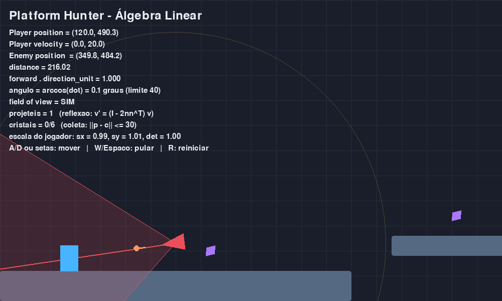

# TDE 03 — Álgebra Linear aplicada a jogos

Melhorias no jogo de plataforma *Platform Hunter* (Python + pygame + numpy), feitas
depois da análise do código-fonte. Cada melhoria usa um conceito de Álgebra Linear
e está num commit separado; o primeiro commit é o código original, para dar para
comparar.



## Como rodar

```bash
pip install pygame numpy
python jogo_algebra_linear.py
```

Controles: A/D ou setas para mover, W/Espaço para pular, R reinicia, ESC sai.

Para conferir as propriedades das matrizes sem abrir o jogo:

```bash
python verificacao.py
```

## Melhorias

### 1. Coordenadas homogêneas e câmera 2D

No original, o inimigo era desenhado com `A p + posição`: a parte linear (`A = R S`)
era uma matriz e a translação era somada depois, porque translação não é
transformação linear em R² (ela tira a origem do lugar). Com o ponto escrito como
`(x, y, 1)`, a translação vira uma matriz 3×3:

```
T(tx, ty) = | 1  0  tx |
            | 0  1  ty |
            | 0  0  1  |
```

Agora o desenho usa uma matriz só, `p_tela = C · T(posição) · R(θ) · S · p_local`,
onde `C` é a translação da câmera. A ordem importa: lendo da direita para a
esquerda, primeiro escala, depois gira, depois leva para a posição no mundo e por
fim para a tela. Todos os pontos do polígono são transformados de uma vez, como
colunas de uma matriz 3 × n.

A câmera virou um vetor `(x, y)`. No original ela só andava na horizontal, e as
plataformas em `y = 650` e `y = 700` ficavam abaixo da tela (altura 600), sem
aparecer. Agora a câmera desce quando o jogador desce.

### 2. Cone de visão desenhado de verdade

O teste de visão do inimigo tem duas condições: `‖d‖ ≤ 420` (norma) e
`forward · u ≥ cos 40°` (produto interno). O desenho original usava raio 260 e só
uma linha, então não mostrava a região que o código testa. Agora cada ponto do arco
é o vetor `forward` girado por `R(t)`, com `t` de −40° a +40°, vezes 420. O cone
fica vermelho quando o jogador está dentro, e o HUD mostra o ângulo
`arccos(forward · u)`.

### 3. Patrulha de ida e volta

No original o inimigo sempre patrulhava para a esquerda e ficava parado em
`x = 120`. Agora:

- ao perder o jogador, `forward` é **projetado** sobre o eixo `E1`
  (`proj = (forward · E1) E1`) e normalizado, então ele segue para o lado em que
  estava olhando;
- no limite da patrulha, `forward` vira `−forward` (multiplicação pelo escalar −1,
  que é uma rotação de 180°).

Com isso dá para passar por trás do inimigo: atrás dele `forward · u` é negativo,
menor que `cos 40°`, e ele não vê o jogador.

### 4. Projéteis com reflexão

Quando vê o jogador, o inimigo atira com velocidade `280 · u` (escalar vezes vetor
unitário). Ao bater numa plataforma, a velocidade é refletida pela matriz de
Householder:

```
H = I − 2 n nᵀ        v' = H v = v − 2 (v · n) n
```

`n` é a normal da face atingida (`±E1` ou `±E2`). `H` é ortogonal com
`det H = −1`, então `‖H v‖ = ‖v‖`: o tiro muda de direção sem perder rapidez. Batendo
no chão, só a componente vertical troca de sinal. O projétil some depois de 2
ricochetes ou 3 segundos.

### 5. Cristais coletáveis

Seis cristais em forma de losango giram e pulsam com `T · R(t) · S(s, s)`, com
`s = 1 + 0,15 sen(3t)`. O jogador pega um cristal quando
`‖centro do jogador − cristal‖ ≤ 30`, ou seja, a coleta é um teste de distância
(um círculo em volta do cristal).

### 6. Squash and stretch com determinante 1

O jogador é desenhado com uma escala não uniforme `S = diag(1/sy, sy)`. No ar ele
estica na vertical conforme a velocidade; num pouso forte ele achata e volta ao
normal. Como `det S = (1/sy) · sy = 1`, a área do retângulo não muda, só a forma.
A origem local fica nos pés, que é o ponto que a transformação linear deixa
parado, então os pés continuam no chão. A colisão usa o retângulo original.

### 7. Correções

- A colisão estimava a posição anterior com `v / FPS`; agora usa `v · dt`, que é o
  deslocamento real do quadro mesmo se o jogo rodar abaixo de 60 FPS.
- Ao chegar na bandeira aparece a mensagem de vitória com os cristais coletados
  (antes o jogo só reiniciava).

## Verificação

`verificacao.py` confere com `assert`:

- `Rᵀ R = I`, `det R = 1` e `R(θ) E1 = (cos θ, sen θ)`;
- coordenadas homogêneas dão o mesmo resultado que `A p + posição`;
- `T R ≠ R T` (a ordem da composição importa);
- `H n = −n`, `H² = I`, `det H = −1` e `‖H v‖ = ‖v‖`;
- o ricochete no chão inverte só a componente vertical;
- `forward · u ≥ cos 40°` exatamente quando o ângulo é no máximo 40°;
- `det S = 1` no squash and stretch;
- a coleta de cristal por distância.
